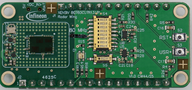
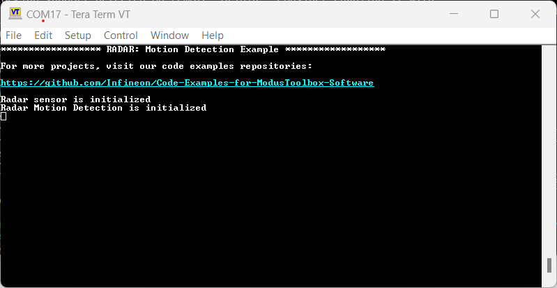
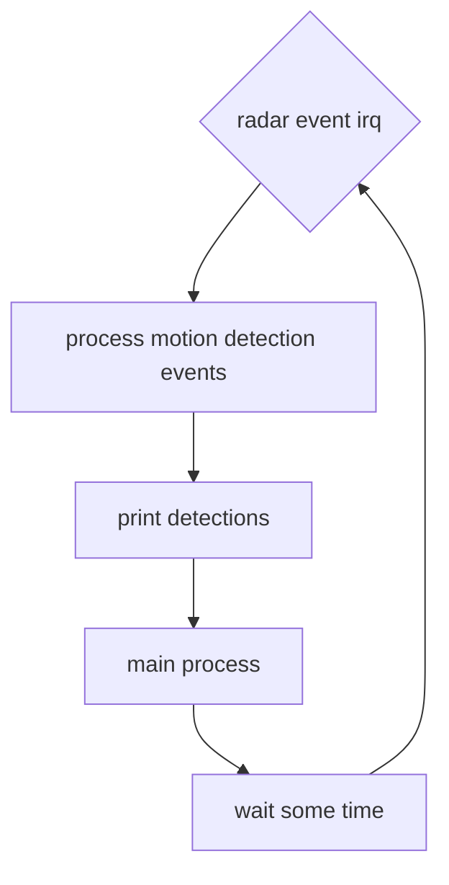

# PSOC&trade; 6 MCU: Motion detection using XENSIV&trade; BGT60CUTR13AIP CMOS radar sensor

This code example demonstrates XENSIV&trade; BGT60CUTR13AIP CMOS 60 GHz radar sensor capabilities by implementing the on-chip feature for motion detection and static presence detection on the connected sensor kit (CSK) hardware platform

<!-- \cond NOTDOXYGEN -->

## Table of contents

- [PSOC™ 6 MCU: Motion detection using XENSIV™ BGT60CUTR13AIP CMOS radar sensor](#psoc-6-mcu-motion-detection-using-xensiv-bgt60cutr13aip-cmos-radar-sensor)
  - [Table of contents](#table-of-contents)
  - [Platform](#platform)
  - [Software requirements](#software-requirements)
    - [ModusToolbox™ (MTB)](#modustoolbox-mtb)
      - [Supported toolchains (make variable 'TOOLCHAIN')](#supported-toolchains-make-variable-toolchain)
    - [Terminal emulator](#terminal-emulator)
    - [Optional software](#optional-software)
  - [Hardware setup: Rapid IoT Connect Developer Kit (CSK)](#hardware-setup-rapid-iot-connect-developer-kit-csk)
  - [Using the code example](#using-the-code-example)
    - [Create the project](#create-the-project)
    - [Open the project](#open-the-project)
  - [Operation](#operation)
  - [Debugging](#debugging)
  - [Design and implementation](#design-and-implementation)
    - [Radar configuration](#radar-configuration)
      - [Table 1. Radar configurations for Motion Detection](#table-1-radar-configurations-for-motion-detection)
      - [Indoor presence detection (indoor\_presence\_detection.h)](#indoor-presence-detection-indoor_presence_detectionh)
    - [Application execution](#application-execution)
    - [Runtime information](#runtime-information)
      - [Table 3. Runtime information based on clock speed 100.00 MHz](#table-3-runtime-information-based-on-clock-speed-10000-mhz)
  - [Related resources](#related-resources)
  - [Other resources](#other-resources)
  - [Document history](#document-history)

<!-- \endcond -->

## Platform

This is the connected sensor kit (CSK) bare-metal version for CYSBSYSKIT-DEV-01. The key features are:

- Uses SPI frequency of 18.75 MHz
- DEBUG UART pins for communication
- Includes LED initialization and control
- Performance measurement capability with timer
- Three-stage processing: motion detection, clustering and clutter localization
- JSON protocol output with host command handling (e.g. `get_info` to query version and sensor info)
- Default power mode set to deep sleep (`DEEP_SLEEP_MODE`)
- Five second UART initialization delay
- Special radar configuration for Japanese market compliance available as header file with suffix _japan.h, e.g. indoor_motion_low_power_japan.h

[View this README on GitHub.](https://github.com/Infineon/mtb-example-psoc6-cmos-radar-motion-detection)

## Software requirements

### ModusToolbox&trade; (MTB)

Downlaod the ModusToolbox&trade; from [Infineon developer center](https://www.infineon.com/design-resources/development-tools/sdk/modustoolbox-software).

Please make sure to download the ModusToolbox&trade; tools package using MTB Setup tools program as it take care of any conflicts within the tools. You can find this MTB setup tool from MTB Dashboard after installing ModusToolbox&trade;. See the [ModusToolbox&trade; tools package installation guide](https://www.infineon.com/ModusToolboxInstallguide) for information about installing and configuring the tools package.

- [ModusToolbox&trade;](https://www.infineon.com/modustoolbox) v3.4 or later
- Board support package (BSP) minimum required version: 5.0.0
- Programming language: C
- Associated parts: All [PSOC&trade; 6 MCU](https://www.infineon.com/cms/en/product/microcontroller/32-bit-psoc-arm-cortex-microcontroller/psoc-6-32-bit-arm-cortex-m4-mcu) parts

#### Supported toolchains (make variable 'TOOLCHAIN')

- GNU Arm&reg; Minimum Embedded Compiler v11.3.1 (`GCC_ARM`) – Default value of `TOOLCHAIN`
- Arm&reg; Compiler v6.22 (`ARM`)
- IAR C/C++ Compiler v9.50.2 (`IAR`)

### Terminal emulator

Install a terminal emulator if you do not have one. Instructions in this document use [Tera Term](https://teratermproject.github.io/index-en.html). Other popular terminal emulators include Putty, RealTerm, and CoolTerm. This code examples requires baud rate of 2000000, with rest as default UART settings for the terminal connection.

### Optional software

This example requires no additional software or tools. However, for radar data visualization and analysis, you can use the XENSIV&trade; CMOS Radar Visualization Tool. This visualization tool can connect to the CSK kit via COM port serial interface and can display the radar data (like detection events with range, angle and speed information) in real-time. For further information, please visit the website <https://www.infineon.com/design-resources/development-tools> to download this tool.

## Hardware setup: Rapid IoT Connect Developer Kit (CSK)

- [Rapid IoT Connect Developer Kit](https://github.com/Infineon/TARGET_CYSBSYSKIT-DEV-01) (`CYSBSYSKIT-DEV-01`) – Default value of `TARGET`
  
This code example requires the XENSIV&trade; BGT60CUTR13AIP radar Wing board as part of the connected sensor kit.

1. Connect the radar shield to the CYSBSYSKIT-DEV-01 kit through the pin headers

   

   **Figure 1. Radar wing board**

2. Connect the CYSBSYSKIT-DEV-01 kit to the PC with the USB cable

   

   **Figure 2. Rapid IoT Connect Developer Kit**

3. Place the CYSBSYSKIT-DEV-01 kit at a fixed location (for example, the corner of a room) to ensure optimal performance of the presence detection application

4. Ensure that the horizontal orientation of the radar wing board is on E-plane, which is indicated on the PCB of the radar wing board close to the antenna array with an "E" marking

> **Note:** The PSOC&trade; 6 Bluetooth&reg; LE Pioneer Kit (CY8CKIT-062-BLE) and the PSOC&trade; 6 Wi-Fi Bluetooth&reg; Pioneer Kit (CY8CKIT-062-WIFI-BT) ship with KitProg2 installed. ModusToolbox&trade; requires KitProg3. Before using this code example, make sure that the board is upgraded to KitProg3. The tool and instructions are available in the [Firmware Loader](https://github.com/Infineon/Firmware-loader) GitHub repository. If you do not upgrade, you will see an error like "unable to find CMSIS-DAP device" or "KitProg firmware is out of date".

## Using the code example

### Create the project

The ModusToolbox&trade; tools package provides the Project Creator as both a GUI tool and a command line tool.

<details><summary><b>Use Project Creator GUI</b></summary>

1. Open the Project Creator GUI tool

   There are several ways to do this, including launching it from the dashboard or from inside the Eclipse IDE. For more details, see the [Project Creator user guide](https://www.infineon.com/ModusToolboxProjectCreator) (locally available at *{ModusToolbox&trade; install directory}/tools_{version}/project-creator/docs/project-creator.pdf*)

2. On the **Choose Board Support Package (BSP)** page, select a kit supported by this code example. See [Supported kits](#hardware-setup-rapid-iot-connect-developer-kit-csk)

   > **Note:** To use this code example for a kit not listed here, you may need to update the source files. If the kit does not have the required resources, the application may not work

3. On the **Select Application** page:

   a. Select the **Applications(s) Root Path** and the **Target IDE**

      > **Note:** Depending on how you open the Project Creator tool, these fields may be pre-selected for you

   b. Select this code example from the list by enabling its check box

      > **Note:** You can narrow the list of displayed examples by typing in the filter box

   c. (Optional) Change the suggested **New Application Name** and **New BSP Name**

   d. Click **Create** to complete the application creation process

</details>

<details><summary><b>Use Project Creator CLI</b></summary>

The 'project-creator-cli' tool can be used to create applications from a CLI terminal or from within batch files or shell scripts. This tool is available in the *{ModusToolbox&trade; install directory}/tools_{version}/project-creator/* directory.

Use a CLI terminal to invoke the 'project-creator-cli' tool. On Windows, use the command-line 'modus-shell' program provided in the ModusToolbox&trade; installation instead of a standard Windows command-line application. This shell provides access to all ModusToolbox&trade; tools. You can access it by typing "modus-shell" in the search box in the Windows menu. In Linux and macOS, you can use any terminal application.

The following example clones the "[Motion Detection](https://github.com/Infineon/mtb-example-psoc6-cmos-radar-motion-detection)" application with the desired name "my-motion-detection" configured for the ** BSP into the specified working directory, *./mtb_projects*:

   ```bash
   mkdir "C:/mtb_projects"
   project-creator-cli --board-id CYSBSYSKIT-DEV-01 --app-id mtb-example-psoc6-cmos-radar-motion-detection --user-app-name my-motion-detection --target-dir "C:/mtb_projects"
   ```

The 'project-creator-cli' tool has the following arguments:

Argument | Description | Required/optional
---------|-------------|-----------
`--board-id` | Defined in the \<id> field of the [BSP](https://github.com/Infineon?q=bsp-manifest&type=&language=&sort=) manifest | Required
`--app-id`   | Defined in the \<id> field of the [CE](https://github.com/Infineon?q=ce-manifest&type=&language=&sort=) manifest | Required
`--target-dir`| Specify the directory in which the application is to be created if you prefer not to use the default current working directory | Optional
`--user-app-name`| Specify the name of the application if you prefer to have a name other than the example's default name | Optional

<br>

> **Note:** The project-creator-cli tool uses the `git clone` and `make getlibs` commands to fetch the repository and import the required libraries. For details, see the "Project creator tools" section of the [ModusToolbox&trade; tools package user guide](https://www.infineon.com/ModusToolboxUserGuide) (locally available at {ModusToolbox&trade; install directory}/docs_{version}/mtb_user_guide.pdf).

</details>

### Open the project

After the project has been created, you can open it in your preferred development environment.

<details><summary><b>Eclipse IDE</b></summary>

If you opened the Project Creator tool from the included Eclipse IDE, the project will open in Eclipse automatically.

For more details, see the [Eclipse IDE for ModusToolbox&trade; user guide](https://www.infineon.com/MTBEclipseIDEUserGuide) (locally available at *{ModusToolbox&trade; install directory}/docs_{version}/mt_ide_user_guide.pdf*).

</details>

<details><summary><b>Visual Studio (VS) Code</b></summary>

Launch VS Code manually, and then open the generated *{project-name}.code-workspace* file located in the project directory.

For more details, see the [Visual Studio Code for ModusToolbox&trade; user guide](https://www.infineon.com/MTBVSCodeUserGuide) (locally available at *{ModusToolbox&trade; install directory}/docs_{version}/mt_vscode_user_guide.pdf*).

</details>

<details><summary><b>Arm&reg; Keil&reg; µVision&reg;</b></summary>

Double-click the generated *{project-name}.cprj* file to launch the Keil&reg; µVision&reg; IDE.

For more details, see the [Arm&reg; Keil&reg; µVision&reg; for ModusToolbox&trade; user guide](https://www.infineon.com/MTBuVisionUserGuide) (locally available at *{ModusToolbox&trade; install directory}/docs_{version}/mt_uvision_user_guide.pdf*).

</details>

<details><summary><b>IAR Embedded Workbench</b></summary>

Open IAR Embedded Workbench manually, and create a new project. Then select the generated *{project-name}.ipcf* file located in the project directory.

For more details, see the [IAR Embedded Workbench for ModusToolbox&trade; user guide](https://www.infineon.com/MTBIARUserGuide) (locally available at *{ModusToolbox&trade; install directory}/docs_{version}/mt_iar_user_guide.pdf*).

</details>

<details><summary><b>Command line</b></summary>

If you prefer to use the CLI, open the appropriate terminal, and navigate to the project directory. On Windows, use the command-line 'modus-shell' program; on Linux and macOS, you can use any terminal application. From there, you can run various `make` commands.

For more details, see the [ModusToolbox&trade; tools package user guide](https://www.infineon.com/ModusToolboxUserGuide) (locally available at *{ModusToolbox&trade; install directory}/docs_{version}/mtb_user_guide.pdf*).

</details>

## Operation

If using a PSOC&trade; 64 "Secure" MCU kit (like CY8CKIT-064B0S2-4343W), the PSOC&trade; 64 device must be provisioned with keys and policies before being programmed. Follow the instructions in the ["Secure Boot" SDK user guide](https://www.infineon.com/dgdlac/Infineon-PSoC_64_Secure_MCU_Secure_Boot_SDK_User_Guide-Software-v07_00-EN.pdf?fileId=8ac78c8c7d0d8da4017d0f8c361a7666) to provision the device. If the kit is already provisioned, copy-paste the keys and policy folder to the application folder.

1. Connect the board to your PC using the provided USB cable through the KitProg3 USB connector

2. Open a terminal program and select the KitProg3 COM port. Set the serial port parameters to 8N1 and 2000000 baud

3. Program the board using one of the following:

   <details><summary><b>Using Eclipse IDE</b></summary>

      1. Select the application project in the Project Explorer

      2. In the **Quick Panel**, scroll down, and click **\<Application Name> Program (KitProg3_MiniProg4)**
   </details>

   <details><summary><b>In other IDEs</b></summary>

   Follow the instructions in your preferred IDE

   </details>

   <details><summary><b>Using CLI</b></summary>

     From the terminal, execute the `make program` command to build and program the application using the default toolchain to the default target. The default toolchain is specified in the application's Makefile but you can override this value manually:

      ```bash
      make program TOOLCHAIN=<toolchain>
      ```

      Example:

      ```bash
      make program TOOLCHAIN=GCC_ARM
      ```

   </details>

4. After programming, the application starts automatically. Confirm that "Motion Detection using XENSIV 60-GHz Radar" is displayed on the UART terminal

   **Figure 3. Terminal output on program startup**

   

## Debugging

You can debug the example to step through the code.

<details><summary><b>In Eclipse IDE</b></summary>

Use the **\<Application Name> Debug (KitProg3_MiniProg4)** configuration in the **Quick Panel**. For details, see the "Program and debug" section in the [Eclipse IDE for ModusToolbox&trade; user guide](https://www.infineon.com/MTBEclipseIDEUserGuide).

> **Note:** **(Only while debugging)** On the CM4 CPU, some code in `main()` may execute before the debugger halts at the beginning of `main()`. This means that some code executes twice – once before the debugger stops execution, and again after the debugger resets the program counter to the beginning of `main()`. See [PSOC&trade; 6 MCU: Code in main() executes before the debugger halts at the first line of main()](https://community.infineon.com/docs/DOC-21143) to learn about this and for the workaround.

</details>

<details><summary><b>In other IDEs</b></summary>

Follow the instructions in your preferred IDE.

</details>

## Design and implementation

This application uses the radar on-chip motion detection feature to detect up to 8 targets in different zones. After the peripheral initialization the radar device is detected and configured with the selected register list. The configuration header is generated from the PC based radar configurator tool.

### Radar configuration

Within this software package, radar configuration header files for Japnese market compliance are included. To use this configuration, select the corresponding header file in *main.c*. The configuration files can be identified by the "_japan" suffix in their file names, for example, "indoor_motion_low_power_japan.h". For more information about the radar configuration, see the [design and implementation](#design-and-implementation) section of this document.

The application contains multiple radar configuration header files, generated by Radar Configuration Tool which is part of [Infineon Developer Center](https://www.infineon.com/design-resources/development-tools/utilities/infineon-developer-center-idc-launcher). The user can switch between configurations by a selecting a header file in main.c. The difference between these configurations and their feature list is summarized in the table below:

#### Table 1. Radar configurations for Motion Detection

 Use case | Active sequence | Range | Update rate (Standby - motion) |     Power consumption (Standby - motion) | Chirp configuration |     Description
 :--------| :--- | :---- | :-----   | :----- | :------------ | :--------
 Indoor low-power     | ULP    | 9 m   | 1-10 Hz  | 174-762 µW | 2 bursts – averaging factor 2   | Low sensitivity and battery-powered indoor devices
 Indoor medium-power  | RD     | 9 m   | 1-10 Hz  | 879 µW - 7 mW | 16 bursts - no averaging | Medium sensitivity and battery-powered indoor devices
 Indoor regular-power | RD+ULP | 9 m   | 10 Hz   | 32 mW  | 32 bursts – averaging factor 8   | High sensitivity and battery-powered outdoor devices
 Outdoor low-power    | ULP    | 20 m  | 1-10 Hz  | 375 µW - 2.736 mW  | 2 bursts – averaging factor 16  | Low sensitivity and battery-powered outdoor devices
 Outdoor medium-power | RD     | 20 m  | 1-10 Hz | 1.6-15 mW  | 16 bursts – averaging factor 8   | Medium sensitivity and battery-powered outdoor devices

<br>

#### Indoor presence detection (indoor_presence_detection.h)

Presence detection usecase detects static targets as well as micro motion targets with field of view, without using post-processing on MCU. It shows the capability of BGT60CUTR13AIP on-chip signal processing. For indoor localization scenarios up to 9m.

- Update rate:
  - Shape set repeats at 4 Hz (RD + ULP sequence combined)
- Power consumption:
  - 32 mW @ 4 Hz
- Chirp configuration:
  - 32 bursts with averaging factor 8
  - 64 samples @ 5 MHz sampling frequency
  - Active sequence(s): RD + ULP
- Max detection range: 9 m
- Time to detect static: 2.5 s
- Off-chip processing (M0, ≤16 kB SRAM):
  - Clustering: ~2 kB
  - Clutter localization & automatic masking: 224 bytes

### Application execution

After initialization, the application runs in an event-driven way. The radar interrupt is used to notify the MCU, and main task then triggers the motion detection module to read the radar registers and decode them to meaningful user event output. The output is sent via serial terminal to the PC in JSON format to display the number of detected targets and their range, speed, and angle.

A protocol handler runs on every loop iteration to process incoming host commands. The supported commands include `get_info`, which returns the firmware version and sensor information.



### Runtime information

These runtime performance figures represent actual execution times measured on target hardware (PSOC&trade; 6 MCU) using high-resolution timer instrumentation. The measurements capture real-world algorithm performance including CPU execution, memory access latency, and complexity variations based on radar sensor data. Timing values show minimum, maximum, and rolling average execution times across multiple radar frames during normal operation.

> **Note:** Execution times are dynamic and vary based on the number and motion characteristics of targets within the radar sensor's detection range. More targets or complex motion patterns result in longer processing times, while scenarios with no detected motion show minimal execution overhead.

This analysis is obtained by enabling `MEASURE_PROCESSING_TIME` in the firmware, which instruments the code with microsecond-precision timer measurements around each algorithm stage. Performance data is transmitted via UART and captured using a Python script for automated documentation updates.

For detailed information about the measurement methodology and build settings, see the [runtime information test documentation](../../tests/runtime-information-algo/README.md).

#### Table 3. Runtime information based on clock speed 100.00 MHz

Algorithm | Min (µs) | Max (µs) | Avg (µs)
----------|----------|----------|----------
Motion Detection | 104 | 7,024 | 4,680

## Related resources

Resources  | Links
-----------|----------------------------------
Application notes  | [AN228571](https://www.infineon.com/AN228571) – Getting started with PSOC&trade; 6 MCU on ModusToolbox&trade; <br>  [AN215656](https://www.infineon.com/AN215656) – PSOC&trade; 6 MCU: Dual-CPU system design <br> [AN79953](https://www.infineon.com/AN79953) – Getting started with PSOC&trade; 4 MCU <br>  [AN85951](https://www.infineon.com/AN85951) – PSOC&trade; 4 and PSOC&trade; 6 MCU CAPSENSE&trade; design guide
Code examples  | [Using ModusToolbox&trade;](https://github.com/Infineon/Code-Examples-for-ModusToolbox-Software) on GitHub
Device documentation | [PSOC&trade; 6 MCU datasheets](https://documentation.infineon.com/html/psoc6/bnm1651211483724.html) <br> [PSOC&trade; 6 technical reference manuals](https://documentation.infineon.com/html/psoc6/zrs1651212645947.html)<br> [PSOC&trade; 4 datasheets](https://www.infineon.com/cms/en/search.html?intc=searchkwr-return#!view=downloads&term=psoc%204&doc_group=Data%20Sheet) <br>[PSOC&trade; 4 technical reference manuals](https://www.infineon.com/cms/en/search.html#!term=psoc%204%20technical%20reference%20manual&view=all)
Development kits | Select your kits from the [Evaluation board finder](https://www.infineon.com/cms/en/design-support/finder-selection-tools/product-finder/evaluation-board)
Libraries on GitHub  | [mtb-pdl-cat1](https://github.com/Infineon/mtb-pdl-cat1) – PSOC&trade; 6 Peripheral Driver Library (PDL)  <br> [mtb-hal-cat1](https://github.com/Infineon/mtb-hal-cat1) – Hardware Abstraction Layer (HAL) library <br> [retarget-io](https://github.com/Infineon/retarget-io) – Utility library to retarget STDIO messages to a UART port <br>  [mtb-pdl-cat2](https://github.com/Infineon/mtb-pdl-cat2) – PSOC&trade; 4 Peripheral Driver Library (PDL) <br>  [mtb-hal-cat2](https://github.com/Infineon/mtb-hal-cat2) – Hardware Abstraction Layer (HAL) library
Middleware on GitHub  | [sensor-xensiv-bgt60cutrxx](https://github.com/Infineon/sensor-xensiv-bgt60cutrxx) – Driver library for XENSIV&trade; CMOS radar sensor and documents <br> [psoc6-middleware](https://github.com/Infineon/modustoolbox-software#psoc-6-middleware-libraries) – Links to all PSOC&trade; 6 MCU middleware
Tools  | [ModusToolbox&trade;](https://www.infineon.com/modustoolbox) – ModusToolbox&trade; software is a collection of easy-to-use libraries and tools enabling rapid development with Infineon MCUs for applications ranging from wireless and cloud-connected systems, edge AI/ML, embedded sense and control, to wired USB connectivity using PSOC&trade; Industrial/IoT MCUs, AIROC&trade; Wi-Fi and Bluetooth&reg; connectivity devices, XMC&trade; Industrial MCUs, and EZ-USB&trade;/EZ-PD&trade; wired connectivity controllers. ModusToolbox&trade; incorporates a comprehensive set of BSPs, HAL, libraries, configuration tools, and provides support for industry-standard IDEs to fast-track your embedded application development

<br>

## Other resources

Infineon provides a wealth of data at [www.infineon.com](https://www.infineon.com) to help you select the right device, and quickly and effectively integrate it into your design.

For more information about the connected sensor kit, see [IoT Sensors Platform](https://www.infineon.com/connectedsensorkit).

## Document history

Document title: *CE242645* – *PSOC&trade; 6 MCU: Motion detection using XENSIV&trade; 60 GHz radar*

 Version | Description of change
 ------- | ---------------------
 1.1.0   | Updated software requirements and hardware setup sections<br>Added JSON protocol module with host command handling (`get_info`)<br>Default power mode changed to deep sleep<br>Startup messages converted to protocol output
 1.0.0   | New code example


<br>

All referenced product or service names and trademarks are the property of their respective owners.

The Bluetooth&reg; word mark and logos are registered trademarks owned by Bluetooth SIG, Inc., and any use of such marks by Infineon is under license.

PSOC&trade;, formerly known as PSoC&trade;, is a trademark of Infineon Technologies. Any references to PSoC&trade; in this document or others shall be deemed to refer to PSOC&trade;.

---------------------------------------------------------

(c) 2026, Infineon Technologies AG, or an affiliate of Infineon Technologies AG. All rights reserved.
This software, associated documentation and materials ("Software") is owned by Infineon Technologies AG or one of its affiliates ("Infineon") and is protected by and subject to worldwide patent protection, worldwide copyright laws, and international treaty provisions. Therefore, you may use this Software only as provided in the license agreement accompanying the software package from which you obtained this Software. If no license agreement applies, then any use, reproduction, modification, translation, or compilation of this Software is prohibited without the express written permission of Infineon.
<br>
Disclaimer: UNLESS OTHERWISE EXPRESSLY AGREED WITH INFINEON, THIS SOFTWARE IS PROVIDED AS-IS, WITH NO WARRANTY OF ANY KIND, EXPRESS OR IMPLIED, INCLUDING, BUT NOT LIMITED TO, ALL WARRANTIES OF NON-INFRINGEMENT OF THIRD-PARTY RIGHTS AND IMPLIED WARRANTIES SUCH AS WARRANTIES OF FITNESS FOR A SPECIFIC USE/PURPOSE OR MERCHANTABILITY. Infineon reserves the right to make changes to the Software without notice. You are responsible for properly designing, programming, and testing the functionality and safety of your intended application of the Software, as well as complying with any legal requirements related to its use. Infineon does not guarantee that the Software will be free from intrusion, data theft or loss, or other breaches (“Security Breaches”), and Infineon shall have no liability arising out of any Security Breaches. Unless otherwise explicitly approved by Infineon, the Software may not be used in any application where a failure of the Product or any consequences of the use thereof can reasonably be expected to result in personal injury.
